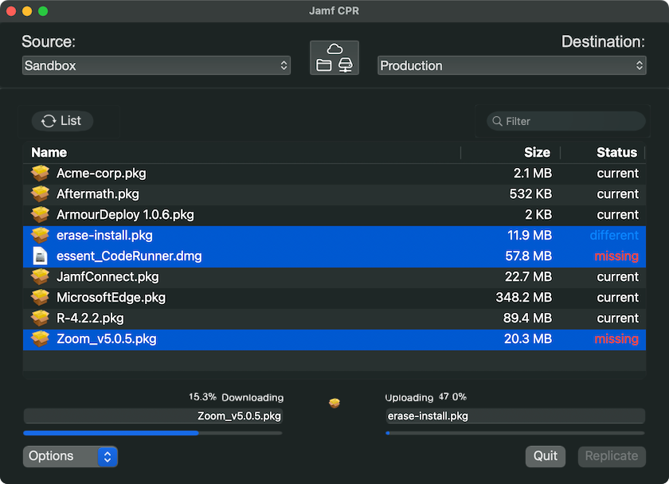
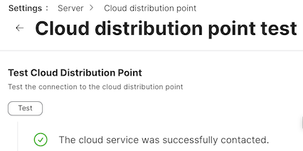

# Jamf Cloud Package Replicator 

   
  

Download the current release: [jamfCPR](https://github.com/BIG-RAT/jamfcpr/releases/latest/download/jamfcpr.zip)<br>



By default the application will submit basic hardware, OS, and jamfCPR application usage to [TelemetryDeck](https://telemetrydeck.com). The data is sent anamously and used to aid in the development of the application. To opt out of data the sending of data click 'Opt out of analytics' at the bottom of the 'About jamfCPR' window.

Copy packages from a directory (local/mounted share/drive), custom S3 bucket, or from one JCDS to another JCDS/S3 bucket/directory/share with the Jamf CPR app. Shares can include local distribution points. The application is scriptable.

For detailed useage instructions see the [Wiki](https://github.com/BIG-RAT/jamfcpr/wiki)
<br><br>
Verify connectivity if no packages have been uploaded.


<br><br>


Packages can be sorted by name, size, or status. The status column makes it easy to see what packages need updating.
<br><br>

Once you have a list of packages from the source server select the package(s) you wish to replicate and click the Replicate button. For the first two methods packages are replicated from the source JCDS/directory/share to the destination JCDS/directory/share. For the last method, where a JCDS is the source, packages are downloaded to ~/Downloads/jamfcpr/, then uploaded to the destination JCDS. By default, once the upload is complete the local copy is deleted. This behavior can be changed by selecting Save from the Options button. In addition you're able to select Save Only, i.e. packages will only be downloaded.
Checksums are used to determine if the package to upload differs from what is already on the JCDS. 

* To override this behavior, and force package(s) to sync, select "Force Sync" under the Options button.

Note, percents shown represent percent of current file being uploaded/downloaded. The status bars below the downloading/uploading text fields represent the progress of all transfers. 

* It can take several minutes for packages to show as available (Jamf Pro syncs with the JCDS once an hour), please be patient waiting for the 'refresh' button to disappear. The logs can be checked to verify the upload, should see something similar to:

```
    20210512_050017 loaded file to data.
    20210512_050017 Perform upload task
    20210512_050023 	 file successfully uploaded.
    20210512_050023 Upload: security.pkg
    20210512_050023 Status: READY
```

Application log is available in ~/Library/Logs/jamfcpr/. You can quickly access the logs folder from the menu bar, View --> Show Logs or ⌘-L.
